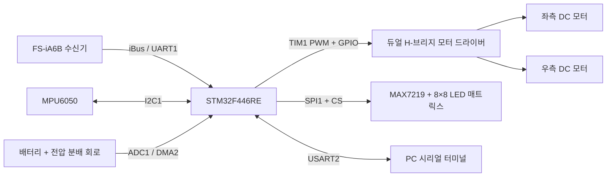
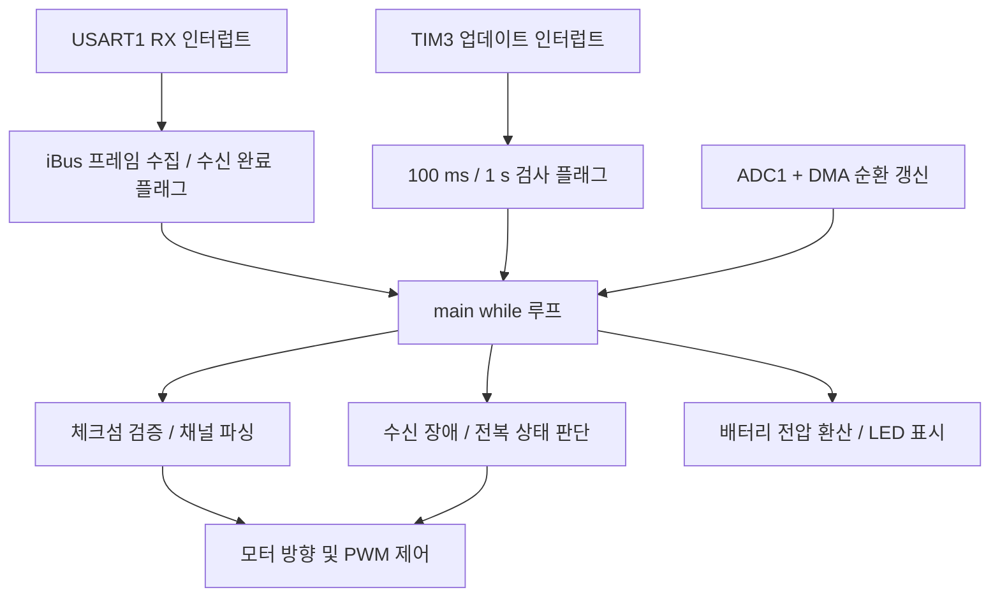

# STM32F4 RC Car

> **STM32F446RE 기반 무선 조종 RC카**  
> UART 인터럽트로 조종기 데이터를 수신하고, PWM으로 DC 모터를 제어하는 개인 임베디드 프로젝트입니다. 수신 장애 및 전복 상황에 대응하는 모터 정지 로직과 배터리 상태 표시 기능을 구현했습니다.

**개발 환경:** `C` · `STM32F446RE` · `STM32CubeIDE` · `STM32 HAL / LL`  
**주요 인터페이스:** `UART` · `TIM/PWM` · `I2C` · `ADC/DMA` · `SPI`  
**실행 구조:** Bare-metal / Super-loop (`main` 브랜치 기준)

[소스 코드](./Core/Src) · [STM32CubeMX 설정 파일](./test.ioc) · [기존 프로젝트 포트폴리오 PDF](./Project_Portfolio.pdf)

## 1. 프로젝트 개요

조종기, 모터 드라이버, 관성 센서, 배터리 측정 회로 등을 STM32 MCU에 연결해 동작하는 RC카를 제작했습니다. 부품 선정부터 하드웨어 결선, MCU 주변장치 설정, 제어 로직 작성, UART 기반 디버깅까지 진행하며 **하드웨어와 펌웨어가 연동되는 과정을 학습**하는 데 중점을 두었습니다.

### 주요 기능

| 기능 | 구현 내용 | 주요 기술 |
| --- | --- | --- |
| 무선 조종 데이터 수신 | FS-iA6B 수신기의 32바이트 iBus 프레임을 인터럽트로 수집·검증·파싱 | USART1, RXNE interrupt |
| 모터 구동 및 조향 | 조종기 스틱 값을 좌·우 모터 속도 및 회전 방향으로 변환 | TIM1 PWM, GPIO |
| 통신 장애 대응 | iBus의 Failsafe 상태 및 일정 시간 동안의 수신 여부를 확인해 PWM 출력 차단 | TIM3 interrupt, timeout |
| 전복 감지 | MPU6050 가속도 Z축 값을 주기적으로 확인해 전복 상태 감지 후 모터 정지 | I2C1, TIM3 |
| 배터리 전압 측정 | 전압 분배 회로 출력을 ADC로 측정하고 DMA로 값을 갱신 | ADC1, DMA2 |
| 배터리 상태 표시 | 측정값을 단계로 변환해 MAX7219 기반 8×8 LED 매트릭스에 표시하는 코드 추가 | SPI1, GPIO CS |
| 시리얼 디버깅 | PC 터미널 연결용 USART2 수신 에코 및 센서 값 확인 코드 | USART2 |

> **구현 상태:** 표는 현재 `main` 브랜치에 포함된 기능을 기준으로 작성했습니다. MAX7219 표시는 코드가 반영되어 있으나, 최종 하드웨어 동작 확인 여부는 별도로 검증할 필요가 있습니다. RTOS는 현재 `main` 브랜치에 적용되어 있지 않습니다.

## 2. 시스템 구성



### 하드웨어 및 개발 환경

| 구분 | 항목 |
| --- | --- |
| MCU | STM32F446RE (Nucleo-F446RE) |
| 무선 수신 | FlySky FS-iA6B / iBus |
| 모터 제어 | 좌·우 DC 모터, PWM 및 방향 제어용 모터 드라이버 |
| 관성 센서 | MPU6050 (I2C) |
| 배터리 측정 | 전압 분배 회로 + STM32 ADC |
| LED 표시 | MAX7219 + 1088AS 계열 8×8 LED 매트릭스 |
| 개발 도구 | STM32CubeIDE, STM32CubeMX 설정(`test.ioc`) |
| 라이브러리 | STM32 HAL 및 LL 혼용 |

## 3. 주요 구현 내용

### 3.1 UART 인터럽트 기반 iBus 수신

- USART1을 **115,200 bps**로 설정하고 RXNE 인터럽트에서 데이터를 바이트 단위로 수신합니다.
- 프레임 시작 바이트 `0x20`, `0x40`을 확인하고 총 **32바이트**를 수신 버퍼에 저장합니다.
- 메인 루프에서 수신 완료 플래그를 확인한 뒤, iBus 체크섬을 검증하고 스틱 채널 값을 추출합니다.
- 인터럽트에서는 바이트 수집을 처리하고, 프레임 검증 및 모터 제어는 메인 루프에서 수행하도록 분리했습니다.

**코드:** [`USART1_IRQHandler()`](./Core/Src/stm32f4xx_it.c) · [`iBus_Check_CHKSUM()` / `iBus_Parsing()`](./Core/Src/FS-iA6B.c)

### 3.2 PWM 기반 차동 조향

조종기 스틱 입력의 중심값(약 `1500`)을 기준으로 전진·후진 입력과 좌·우 조향 입력을 구분합니다.

```c
int16_t throttle = go_back - 1500;
int16_t steer    = left_right - 1500;

int16_t left_motor  = throttle - steer;
int16_t right_motor = throttle + steer;
```

- 좌·우 모터 출력의 부호로 회전 방향 GPIO를 결정합니다.
- 출력의 절댓값을 TIM1의 PWM 비교 레지스터(`CCR1`, `CCR2`)에 반영합니다.
- TIM1 CH1/CH2가 각각 좌·우 모터 PWM을 담당합니다. 현재 설정은 **약 4 kHz PWM**입니다(타이머 클록 168 MHz, ARR=41999).

**코드:** [`Motor_Control()`](./Core/Src/main.c)

### 3.3 Failsafe 및 전복 감지

**무선 수신 장애 대응**

- iBus 데이터에 포함된 Failsafe 정보를 확인합니다.
- TIM3 주기 인터럽트로 1초 주기의 검사 플래그를 만들고, 해당 구간에 정상 파싱된 iBus 프레임이 없으면 수신 장애로 판단합니다.
- 장애가 감지되면 TIM1의 좌·우 PWM 비교값을 `0`으로 설정하고 경고 LED를 켭니다.

**전복 감지**

- TIM3에서 생성한 100 ms 플래그에 따라 MPU6050의 가속도 값을 읽습니다.
- Z축 가속도가 음수인 상태가 반복되는지를 확인해 전복 플래그를 설정합니다.
- 전복으로 판단되면 PWM을 0으로 설정하여 모터 구동을 정지합니다.

**코드:** [`TIM3_IRQHandler()`](./Core/Src/stm32f4xx_it.c) · [`main()`](./Core/Src/main.c)

### 3.4 ADC + DMA 배터리 측정 및 SPI 표시

- ADC1의 **12비트 변환값**을 DMA2 Stream0의 순환 모드로 수신합니다.
- 전압 분배 비율을 반영한 코드 내 환산 계수로 배터리 전압을 계산합니다.
- 계산한 전압을 8.4 V 기준의 단계 값으로 변환해 MAX7219의 표시 데이터로 전달합니다.
- MAX7219에는 SPI1으로 주소·데이터 2바이트를 전송하고 GPIO로 CS(LOAD)를 제어합니다.

**코드:** [`main()`](./Core/Src/main.c) · [`max7219_send()` / `display_voltage_level()`](./Core/Src/max7219.c)

> 현재 배터리 잔량 표시는 **전압 기반 단계 표시**이며, 실제 잔여 용량(SoC)을 정밀 추정하는 기능은 아닙니다.

## 4. 소프트웨어 구조

현재 애플리케이션은 **인터럽트 + Super-loop** 구조입니다.



| 경로 | 역할 |
| --- | --- |
| [`Core/Src/main.c`](./Core/Src/main.c) | 초기화, 메인 제어 루프, 모터 제어, Failsafe 처리, 전압 계산 |
| [`Core/Src/stm32f4xx_it.c`](./Core/Src/stm32f4xx_it.c) | USART1/2, TIM3, DMA 인터럽트 핸들러 |
| [`Core/Src/FS-iA6B.c`](./Core/Src/FS-iA6B.c) | iBus 체크섬 검사 및 채널 데이터 파싱 |
| [`Core/Src/MPU6050.c`](./Core/Src/MPU6050.c) | MPU6050 초기화 및 가속도/자이로 센서 데이터 읽기 |
| [`Core/Src/max7219.c`](./Core/Src/max7219.c) | MAX7219 명령 전송 및 LED 매트릭스 표시 |
| [`test.ioc`](./test.ioc) | MCU 핀 배치 및 주변장치 설정 |

USART1/2와 TIM1/3은 **LL API 중심**, I2C1·ADC1·DMA·SPI1은 **HAL API 중심**으로 구성했습니다. MPU6050 모듈 등은 기존 드라이버 코드를 참고/활용했고, 주변장치 연결 및 RC카의 제어·보호 로직을 프로젝트에 맞게 구성했습니다.

## 5. 개발 및 디버깅 경험

- **UART 디버깅:** USART2와 PC 터미널을 이용해 수신 데이터를 확인하며 조종 입력과 펌웨어 동작을 점검했습니다.
- **하드웨어 점검:** 보드/전원 이상 상황에서 멀티미터로 배터리 및 MCU 핀 전압을 측정하는 방식으로 문제 범위를 좁혔습니다.
- **모듈 통합:** 무선 수신기, 모터 드라이버, IMU, 전압 측정 회로 등 서로 다른 인터페이스의 부품을 하나의 MCU 시스템으로 통합했습니다.

## 6. 실행 및 빌드

1. STM32CubeIDE에서 이 저장소의 STM32 프로젝트를 가져옵니다.
2. [`test.ioc`](./test.ioc)에서 MCU 및 핀 설정을 확인합니다.
3. 실제 회로에 맞춰 FS-iA6B, 모터 드라이버, MPU6050, 전압 분배 회로, MAX7219를 연결합니다.
4. 프로젝트를 빌드하고 ST-LINK로 STM32F446RE에 다운로드합니다.
5. **처음에는 모터 구동 전원을 분리한 상태에서** UART 수신 및 주변장치 동작을 확인한 후, 안전한 조건에서 구동을 시험합니다.

> 배선도/전원 구성이 사용자 환경에 따라 달라질 수 있습니다. 특히 MCU 입력 핀에 배터리 전압을 직접 연결하지 않도록 주의해야 합니다.

## 7. 개선 계획

- [ ] MAX7219 표시 기능의 실제 하드웨어 동작 확인 및 표시 범위 보정
- [ ] 인터럽트와 메인 루프 사이에서 공유하는 데이터/플래그의 동기화 및 수신 버퍼 처리 개선
- [ ] 블로킹 I2C 센서 읽기의 비동기화 검토
- [ ] 수신 끊김·전복·배터리 저전압 조건의 테스트 절차와 결과 기록
- [ ] 필요 시 FreeRTOS 기반 태스크 구조로 리팩터링
- [ ] 배선도, 실물 사진 및 시연 영상 추가

---

**참고:** 이 README는 공개 저장소의 `main` 브랜치 코드를 기준으로 작성했습니다. 사진·시연 영상, 모든 기능의 실기 검증 결과는 아직 README에 포함하지 않았습니다.
