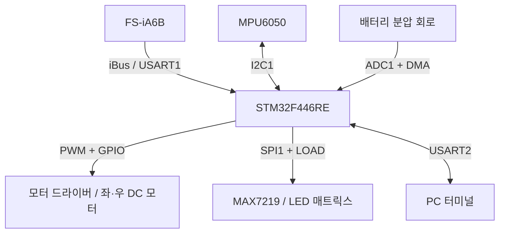
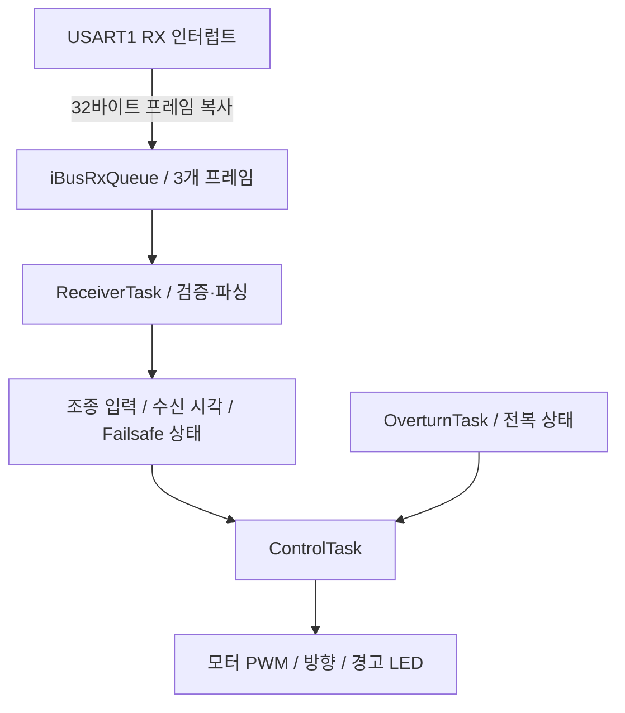

# STM32F446RE RC Car

> STM32F446RE 기반 무선 조종 RC카를 제작하고, 슈퍼루프 구조를 FreeRTOS 태스크 구조로 확장한 개인 임베디드 프로젝트입니다.

`C` · `STM32F446RE` · `STM32CubeIDE` · `HAL / LL` · `FreeRTOS` · `CMSIS-RTOS2`

무선 조종 데이터 수신, 좌·우 DC 모터 제어, 통신 장애·전복 감지, 배터리 전압 표시를 하나의 MCU에서 구현했습니다. 주변장치 통합과 데이터시트 기반 MAX7219 드라이버 작성, 인터럽트와 태스크 사이의 데이터 전달에 중점을 두었습니다.

## 브랜치 안내

| 브랜치 | 실행 구조 | 주요 내용 |
| --- | --- | --- |
| [main](https://github.com/qwerasdfuiop/rc_car/tree/main) | 인터럽트 + 슈퍼루프 | 기본 주행·보호 로직, 배터리 전압 표시 |
| [freertos](https://github.com/qwerasdfuiop/rc_car/tree/freertos) | FreeRTOS + CMSIS-RTOS2 | 4개 태스크 분리, iBus 수신 큐, 주기별 실행 및 공유 데이터 보호 |

**FreeRTOS 구현은 `freertos` 브랜치에서 확인할 수 있습니다.** 아래 태스크 및 큐 설명도 해당 브랜치를 기준으로 합니다.

## 1. 주요 기능

| 기능 | 구현 내용 | 주변장치 / 기술 |
| --- | --- | --- |
| 무선 조종 수신 | FS-iA6B의 32바이트 iBus 프레임 수집, 체크섬 검사, 채널 파싱 | USART1, RXNE 인터럽트 |
| 주행 및 차동 조향 | 스틱 입력을 좌·우 모터 출력으로 변환하고 회전 방향·PWM 제어 | TIM1 CH1/CH2, GPIO |
| 통신 장애 대응 | 마지막 정상 프레임 처리 후 100 ms 이상 경과하거나 수신 데이터의 Failsafe 판정 시 PWM 차단 | HAL tick, 상태 플래그 |
| 전복 감지 | MPU6050의 Z축 가속도 부호를 반복 확인해 전복 상태 설정 | I2C1 |
| 배터리 전압 측정 | 분압 회로 출력을 12비트 ADC로 변환하고 DMA로 갱신 | ADC1, DMA2 |
| 배터리 상태 표시 | 전압을 단계로 환산해 MAX7219 LED 매트릭스에 표시 | SPI1, GPIO LOAD |
| 시리얼 디버깅 | PC 터미널 연결 및 수신 에코 | USART2 |

## 2. 하드웨어 구성

| 구분 | 구성 |
| --- | --- |
| MCU 보드 | Nucleo-F446RE / ARM Cortex-M4 |
| 무선 수신기 | FlySky FS-iA6B |
| 구동부 | 좌·우 DC 모터 및 듀얼 H-브리지 모터 드라이버 |
| 관성 센서 | MPU6050 |
| 표시 장치 | MAX7219 + 1088AS 계열 8×8 LED 매트릭스 |
| 전압 측정 | 저항 분압 회로 + ADC 입력 |
| 개발 도구 | STM32CubeIDE, STM32CubeMX, ST-LINK |



핀 배치와 주변장치 설정은 사용할 브랜치의 `test.ioc`에서 확인할 수 있습니다.

## 3. FreeRTOS 소프트웨어 구조

### 태스크 구성

| 태스크 | 우선순위 | 실행 조건 | 역할 |
| --- | --- | --- | --- |
| `ControlTask` | High | 10 ms 주기 | 통신 타임아웃 검사, 보호 상태에 따른 모터 제어 |
| `ReceiverTask` | AboveNormal | 수신 큐 대기 | 체크섬 검사, 채널 파싱, 수신 시각·Failsafe 상태 갱신 |
| `OverturnTask` | Normal | 100 ms 주기 | 가속도 읽기 및 전복 상태 갱신 |
| `DisplayTask` | Low | 200 ms 주기 | ADC 값의 전압 환산 및 LED 표시 |

주기 태스크는 `vTaskDelayUntil()`을 사용합니다. 수신 태스크는 `osMessageQueueGet(..., osWaitForever)`로 프레임이 도착할 때까지 대기합니다. 표의 주기는 코드의 설정값이며, 실제 실행 지연을 측정한 결과는 아닙니다.

### iBus 프레임 전달



- ISR은 바이트 수집과 프레임 큐 전달을 담당하고, 체크섬 검사와 파싱은 수신 태스크에서 처리합니다.
- 큐는 **32바이트 메시지 3개**를 저장하며, ISR에서는 대기 시간 `0`으로 전송합니다.
- 프레임을 큐에 복사해 ISR 수신 버퍼와 태스크 처리 데이터를 분리했습니다.
- 파싱된 `iBus` 구조체의 대입과 제어 태스크의 채널 값 읽기에 임계구역을 적용했습니다.

**코드:** [태스크·제어 로직](https://github.com/qwerasdfuiop/rc_car/blob/freertos/Core/Src/main.c) · [UART ISR](https://github.com/qwerasdfuiop/rc_car/blob/freertos/Core/Src/stm32f4xx_it.c)

### 슈퍼루프에서 변경한 점

| 항목 | 슈퍼루프 (`main`) | FreeRTOS (`freertos`) |
| --- | --- | --- |
| 기능 실행 | 하나의 메인 루프에서 순차 처리 | 제어·수신·센서·표시 태스크로 분리 |
| 주기 관리 | TIM3 검사 플래그와 루프 실행 흐름 | 태스크별 `vTaskDelayUntil()` |
| 프레임 전달 | 공유 수신 버퍼와 완료 플래그 | 메시지 큐를 통한 프레임 복사 |
| 수신 대기 | 루프에서 완료 플래그 확인 | 큐에서 블로킹 대기 |
| 실행 우선순위 | 루프 내 호출 순서에 의존 | 모터 제어와 수신에 높은 우선순위 부여 |

센서 읽기와 표시 작업을 각각의 태스크로 분리해 기능별 실행 주기와 우선순위를 명시했습니다. 다만 I2C·SPI 전송 자체는 블로킹 API를 사용하며, RTOS 적용에 따른 응답시간 개선 수치는 아직 측정하지 않았습니다.

## 4. 주요 구현

### PWM 기반 차동 조향

스틱 중심값 `1500`을 기준으로 전후진 입력과 조향 입력을 계산합니다.

```c
int16_t throttle = go_back - 1500;
int16_t steer = left_right - 1500;

int16_t left_motor = throttle - steer;
int16_t right_motor = throttle + steer;
```

각 출력의 부호로 모터 방향 GPIO를 설정하고, 절댓값을 TIM1의 `CCR1`·`CCR2`에 반영합니다. 현재 코드는 좌·우 모터의 속도 차이를 이용하는 차동 조향 방식입니다.

### 통신 장애 및 전복 시 모터 정지

- 체크섬이 정상인 프레임을 처리할 때 `last_ibus_rx_tick`을 갱신합니다.
- `ControlTask`가 10 ms마다 경과 시간을 확인하고, **100 ms 이상**이면 `sigfail_flag`를 설정합니다.
- 수신 데이터에서 추출한 Failsafe 값도 정지 판단에 사용합니다.
- `sigfail_flag` 또는 `overturn_flag`가 설정되면 좌·우 PWM 비교값을 `0`으로 만들고 적색 LED를 켭니다.
- 전복 판정은 100 ms마다 읽은 `Az < 0` 조건이 연속 5회 성립하면 설정합니다. 정상 방향으로 돌아온 뒤 `RH` 채널이 `1400~1600` 범위를 벗어나면 전복 플래그를 해제합니다.

통신 장애는 정상 프레임 처리 결과에 따라 해제되며, 전복 상태는 위의 별도 해제 조건을 사용합니다.

**코드:** [타임아웃·파싱](https://github.com/qwerasdfuiop/rc_car/blob/freertos/Core/Src/FS-iA6B.c) · [모터 제어·전복 판정](https://github.com/qwerasdfuiop/rc_car/blob/freertos/Core/Src/main.c)

### MAX7219 드라이버 및 배터리 표시

MAX7219 레지스터 설정과 주소·데이터 전송 함수를 작성했습니다.

| 레지스터 | 주소 | 설정값 | 의미 |
| --- | --- | --- | --- |
| Display Test | `0x0F` | `0x00` | 테스트 모드 해제 |
| Shutdown | `0x0C` | `0x01` | 정상 동작 |
| Scan Limit | `0x0B` | `0x07` | DIG0~DIG7 스캔 |
| Intensity | `0x0A` | `0x08` | 밝기 설정 |
| Decode Mode | `0x09` | `0x00` | 숫자 디코딩 없이 비트 패턴 사용 |

SPI로 주소와 데이터 총 2바이트를 전송하고, GPIO로 LOAD를 LOW → HIGH 전환합니다. 초기화 시 8개 표시 레지스터를 지운 뒤, 배터리 단계에 해당하는 패턴을 주소 `4`·`5`에 기록합니다.

ADC 값은 코드의 환산 계수 `0.002417f`로 전압으로 변환합니다. `freertos`의 단계 계산은 현재 `7.4 V`를 기준으로 하고 상한을 8단계로 제한합니다. 이 값은 현재 구현의 환산 기준이며, 배터리 완충 전압이나 정밀한 잔여 용량 추정값을 의미하지 않습니다.

**코드:** [MAX7219 드라이버](https://github.com/qwerasdfuiop/rc_car/blob/freertos/Core/Src/max7219.c)

## 5. 소스 코드 안내

| 파일 | 역할 |
| --- | --- |
| `Core/Src/main.c` | 초기화, 모터 제어, 보호 로직, 전압 환산. FreeRTOS 브랜치에서는 태스크·큐 생성 및 태스크 본문 포함 |
| `Core/Src/stm32f4xx_it.c` | UART 및 DMA 등의 인터럽트 처리 |
| `Core/Src/FS-iA6B.c` | iBus 체크섬, 채널 파싱, 통신 타임아웃 |
| `Core/Src/MPU6050.c` | 센서 초기화 및 데이터 읽기 |
| `Core/Src/max7219.c` | MAX7219 초기화, SPI 전송, 표시 패턴 |
| `Core/Inc/FreeRTOSConfig.h` | FreeRTOS 커널 설정 (`freertos` 브랜치) |
| `test.ioc` | STM32CubeMX 핀·주변장치·미들웨어 설정 |

[main 소스](https://github.com/qwerasdfuiop/rc_car/tree/main/Core/Src) · [FreeRTOS 소스](https://github.com/qwerasdfuiop/rc_car/tree/freertos/Core/Src)

## 6. 빌드 및 실행

1. 저장소를 복제하고 원하는 실행 구조의 브랜치를 선택합니다.

   ```bash
   git clone https://github.com/qwerasdfuiop/rc_car.git
   cd rc_car
   git switch freertos
   ```

   슈퍼루프 버전은 `git switch main`으로 선택합니다.

2. STM32CubeIDE에서 **File → Import → General → Existing Projects into Workspace**로 프로젝트를 가져옵니다.
3. 선택한 브랜치의 `test.ioc`를 확인하고 실제 배선을 핀 설정에 맞춥니다.
4. 프로젝트를 빌드한 뒤 ST-LINK로 보드에 다운로드합니다.
5. 수신·센서·표시 동작을 확인하고 주행, 수신 끊김, 전복 및 복구 조건을 점검합니다.

## 7. 개발 과정과 개선할 점

슈퍼루프 기반으로 주변장치와 주행 기능을 통합한 뒤, FreeRTOS를 적용하면서 기능별 태스크 분리, 큐 기반 프레임 전달, 공유 구조체 보호를 구현했습니다. MAX7219는 데이터시트를 바탕으로 초기화 및 표시 함수를 작성했으며, 하드웨어 문제를 점검할 때는 PC 시리얼 터미널과 멀티미터를 활용했습니다.

앞으로 보완할 항목은 다음과 같습니다.

- [ ] 큐 포화 시 프레임 유실 횟수 기록 및 처리 정책 정리
- [ ] 공유 상태 플래그와 전복 해제용 채널 읽기의 동기화 검토
- [ ] 모터 혼합 출력의 범위 제한 및 스틱 중립 구간 적용
- [ ] 배터리 전압 환산·표시 단계 보정
- [ ] 태스크 실행시간·스택 사용량·장애 감지 후 정지 지연 측정
- [ ] 배선도, 실물 사진, 주행·보호 동작 영상 및 시험 결과 추가

> 구현 설명은 저장소 코드 기준입니다. 실행 주기와 임계값은 설정값이며, 실측 성능이나 모든 장애 조건에 대한 검증을 의미하지 않습니다.
